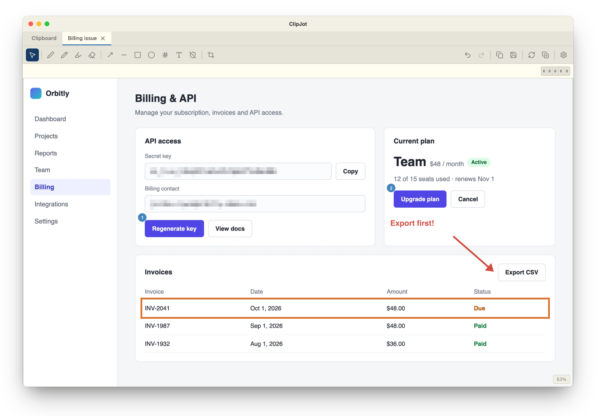

# ClipJot

A lightweight desktop app for editing images directly from the clipboard. Paste an image, annotate it, and copy it back — all without leaving your workflow.

**Website & downloads: [clipjot.app](https://clipjot.app)** · free and open source for macOS and Windows

[](https://clipjot.app)

## Features

- Paste images from clipboard and edit them instantly
- Annotations: arrows, lines, rectangles, ellipses, numbered callouts, text
- Freehand drawing: pen, pencil, marker, eraser
- Redaction: solid, pixelate, blur
- Crop with aspect ratio presets
- Undo/redo
- Multiple tabs
- Copy edited image back to clipboard, or save to file
- Global keyboard shortcut to open/focus the app (⌘⇧J / Ctrl+Shift+J)

## Tech Stack

- **Runtime/Tooling:** Bun
- **Frontend:** Vue 3, TypeScript, Vite
- **Desktop:** Tauri v2
- **Styling:** Flexoki color scheme

## Prerequisites

- [Bun](https://bun.sh/)
- [Rust](https://www.rust-lang.org/tools/install) (for Tauri)
- [Tauri prerequisites](https://v2.tauri.app/start/prerequisites/) for your OS

## Development

Install dependencies:

```bash
bun install
```

Start the dev server (Tauri app with hot reload):

```bash
bun run tauri dev
```

Run the Vite dev server only (no desktop window):

```bash
bun run dev
```

## Building

```bash
bun run tauri build
```

Tauri Builder for Windows: https://hub.docker.com/r/websmurf/tauri-builder

This produces a native app bundle in `src-tauri/target/release/bundle/`.

## Releasing

Bump the version across all config files, commit, tag, and push to GitHub in one step:

```bash
bun scripts/bump-version.ts 1.1.0
```

This updates `package.json`, `src-tauri/tauri.conf.json`, and `src-tauri/Cargo.toml`, then creates a commit, a `v*` tag, and pushes both. The CI workflow picks up the tag and builds a draft GitHub release automatically.

## Testing

```bash
bun test
```

## Type Checking

```bash
bun run tsc
```

## Project Structure

```
ClipJot/
├── src/                    # Vue frontend
│   ├── components/         # UI components
│   ├── composables/        # Vue composables (state, logic)
│   ├── commands/           # Undo/redo command objects
│   ├── types/              # TypeScript type definitions
│   ├── utils/              # Utility functions
│   └── assets/             # CSS and static assets
├── src-tauri/              # Tauri/Rust backend
│   ├── src/                # Rust source (lib.rs, main.rs)
│   ├── icons/              # App icons
│   └── tauri.conf.json     # Tauri configuration
├── test/                   # Unit tests
├── website/                # clipjot.app (Astro), deployed to GitHub Pages from main
└── docs/                   # Project documentation and plans
```

## License

ClipJot is free software, licensed under the [GNU General Public License v3.0](LICENSE).
